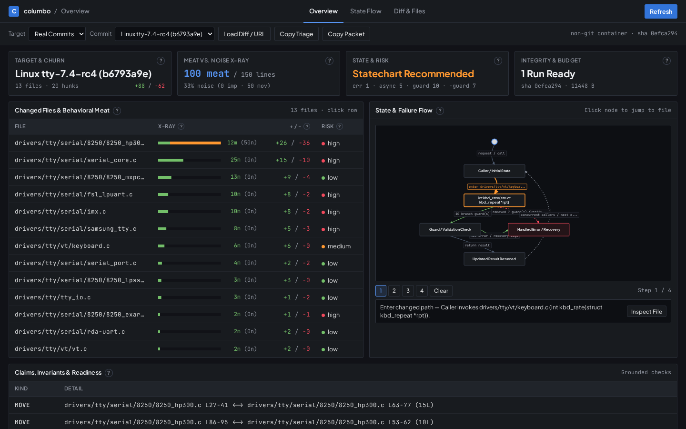
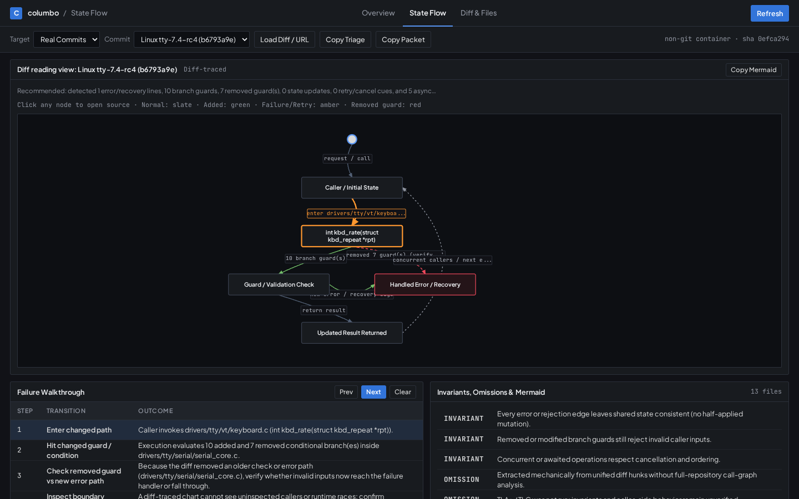
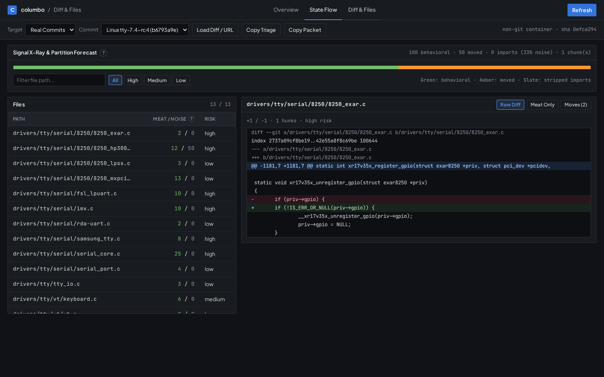

# columbo

**Deterministic diff compiler, bounded code-review CLI, and local verification dashboard for human and AI-agent workflows.**

`columbo` (package `columbo-review`; `columbo` and `meat` invoke the same CLI) reduces large git diffs into smaller reading diffs, strips provable boilerplate without hiding behavioral edits, extracts diff-traced state/failure walkthroughs, and stores hash-checked review evidence in Git metadata (`columbo-state-v1`). TypeScript in `src/` is the active implementation with zero runtime npm dependencies.

---

## How It Improves Your Workflow

Reviewing agent-generated or high-churn changes fails for two reasons: boilerplate drowns out behavioral edits, and agents declare changes "verified" after stale or partial checks. `columbo` addresses both with offline, repeatable tooling:

1. **Separate proven noise from behavioral changes before reading**
   Every changed `+`/`-` line is partitioned into **Stripped Imports**, **Exact Moves**, and residual **Behavioral Meat** (`Meat Only`). Reviewers and agents spend attention on actual logic changes rather than header shuffling or relocated helper functions.
2. **Triage risk hotspots instead of reading alphabetically**
   Files are ranked by churn, state mutations, error/recovery paths, retry/cancel loops, and branch guards, alongside a diff-traced `State & Failure Flow` diagram.
3. **Bind AI-agent context to exact byte snapshots**
   `-inventory`, `-evidence`, and `-plan` paginate diffs deterministically by byte offset and SHA-256 `input_digest`, while `columbo snapshot` / `record` / `status` mark saved claims `needs_recheck` automatically whenever underlying bytes change.

### Real-World Benchmark: `torvalds/linux`

Running `columbo` offline (no API key) against real Linux kernel merge commits:

| Commit (`torvalds/linux`) | Raw Diff | Meat vs. Noise X-Ray | What `columbo` Surfaced |
|---|---|---|---|
| `b6793a9e2a3c` (`tty-7.4-rc4`) | `13` files, `150` changed lines (`11,448 B`) | **`100` meat / `50` noise (`33%` noise)** | Proved two relocated code blocks in `8250_hp300.c` (`L27-41 <-> L63-77`, `L86-95 <-> L53-62`) were pure zero-edit moves; flagged `10` branch guards (e.g., `!IS_ERR_OR_NULL(priv->gpio)`) and medium-risk changes in `fsl_lpuart.c`, `imx.c`, and `serial_core.c`. |
| `f11fe7603df0` (`usb-7.3-rc4`) | `32` files, `971` changed lines (`74,070 B`) | **`935` meat / `36` moves (`4%` noise)** | Verified single-run compiler eligibility (`1` partition); highlighted `high` signal files (`io_edgeport.c`, `xhci-ring.c`, `ucsi.c`) with `28` async/concurrency cues, `17` retry/cancel cues, and `73` guards. |

---

## Web Workbench UI & UX

Start the Grafana-inspired dark verification cockpit (`npm start`, default `http://localhost:3000`) to inspect local Git commits, staged/working-tree diffs, built-in samples, or any pasted unified diff across three focused tabs:

### 1. Overview
KPI cards (`Target & Churn`, `Meat vs. Noise X-Ray`, `State & Risk`, `Integrity & Budget`), ranked **Changed Files & Behavioral Meat** table with stacked Green/Amber/Slate signal bars, live **State & Failure Flow** SVG walkthrough, **Claims, Invariants & Readiness**, and one-click **Copy Triage** (`columbo.triage.v1` JSON) / **Copy Packet** actions for AI agents.



### 2. State Flow
Interactive `Diff-traced` Mermaid `stateDiagram-v2` with highest-signal click-to-jump source file mapping, step-by-step **Failure Walkthrough**, and explicit **Invariants & Omissions** (stating clearly when full call-graph or `tlc` model checking was not run).



### 3. Diff & Files
Whole-diff **Signal X-Ray & Partition Forecast**, risk/path filtering, `Meat / Noise` ratios, and per-file inspector switching between **Raw Diff**, compiler-stripped **Meat Only**, and **Moves** (verified relocated block pairs). You can also load any public GitHub `/commit/`, `/pull/`, or `/compare/base...head` URL or pasted unified diff via **Load Diff / URL**.



---

## Truth Model: What Is Deterministic vs. Heuristic

Agents and human reviewers should know which outputs are mathematically guaranteed and which are triage hints:

| Output | Guarantee | How It Works | Safe Agent Usage |
|---|---|---|---|
| **Stripped Imports (`imp`) & `Meat Only`** | **Deterministic** | `src/meat/imports.ts` classifies language import/include scaffolding; `editplan.ts` preserves hunk structure and surrounding headers. | Safe to skip import clutter when skimming. |
| **Exact Moves (`mov`)** | **Deterministic (Byte-Exact)** | `src/meat/moves.ts` pairs `-` and `+` blocks across hunks **only** when rows are byte-identical modulo constant indentation (`>= 3` substantive rows and `>= 48` non-space bytes). | Safe to treat as verified zero-edit relocations (`L_old <-> L_new`). |
| **Generated / Lockfiles (`gen`)** | **Deterministic (Pattern/Banner)** | Matches standard lockfiles (`package-lock.json`, `pnpm-lock.yaml`, `yarn.lock`, `Cargo.lock`, `go.sum`, `poetry.lock`, etc.), minified/generated suffixes, and explicit `Code generated ... DO NOT EDIT` / `@generated` banners (`src/cli/shape.ts`). | Safe to fold out of first-pass reading; counts remain explicitly reported in X-Ray and `columbo.triage.v1`. |
| **Behavioral Meat (`meat` / `m`)** | **Conservative Residual** | `totalChangedLines - imp - mov - gen`. Anything not proven to be an import, byte-exact move, or generated/lockfile stays in `meat` (no speculative hiding in offline X-Ray). | Never hides a behavioral edit, though formatting/comment tweaks remain until full LLM abridging runs. |
| **Snapshot SHA, Partitions & Stale State** | **Deterministic** | SHA-256 `input_digest`, UTF-8 byte ranges (`-inventory`/`-evidence`), and `columbo-state-v1` byte checks (`needs_recheck`, scoped strictly to local Git targets). | Safe ground truth for pagination and freshness checks. |
| **`Risk` (`high`/`med`/`low`), Signals & `State Flow`** | **Heuristic Triage** | Regex scans over diff hunks for removed/added branch guards, state writes, error/kernel recovery idioms (`IS_ERR*`, `WARN_ON*`, `-E*`, `try`/`catch`/`throw`), async/locks, and retry/cancel cues (`src/cli/dashboard.ts`, `src/cli/statechart.ts`). | **Priority pointer only.** A `low` rating does not prove safety (e.g., subtle single-line pointer or arithmetic bugs still require reading the code). |

---

## Technical Reference

### Requirements & Installation

- **Git** and **Node.js `22.18+`** (`24` recommended; native TypeScript execution for dev scripts)
- **Zero runtime dependencies** (`package.json` `dependencies: {}`)

```sh
npm ci
npm run setup     # builds dist/, links columbo & meat, installs personal skills, runs -doctor
```

> On Linux systems with global Node installs where `npm link` hits `EACCES`, use `nvm` or `npm config set prefix ~/.local` before `npm run setup`. Without global linking, run `node dist/cli/main.js` directly.

### Starting the Web Workbench

```sh
npm start         # serves dashboard + API on http://0.0.0.0:${PORT:-3000}
```

Key HTTP endpoints exposed by `server.js`:
- `GET /` — Verification dashboard UI
- `GET /api/health` — Server status (`{ ok: true }`)
- `GET` / `POST /api/dashboard` (`{ mode: "auto" | "sample" | "git" | "github" | "paste", sampleId?, gitTarget?, url?, diff?, title? }`) — Full `DashboardPayload` (`xray`, `files`, `statechart`, `nodeFileMap`, `repo`, `ledger`, `doctor`, and `agentTriage` (`columbo.triage.v1`))
- `POST /api/statecharts/analyze` (`{ diff, title }`) — Diff-traced `StatechartArtifact`
- `GET /api/samples` & `GET /api/samples/:id` — Bundled fixture diffs

### Core CLI Commands

Place flags **before** any revision (`HEAD`, `main...HEAD`, `--staged`, `-w`). Use `--stdin` or shell redirection for external diffs:

| Goal | Command | Notes |
|---|---|---|
| One-shot offline triage (`v1`) | `columbo triage HEAD [--json\|--markdown] [--top N] [--risk high\|medium\|low]` | Emits `columbo.triage.v1`: deterministic X-Ray (`imp`/`mov`/`gen`/`meat`, SHA-256) + heuristic risk order (`notSafetyProof: true`), invariants, and next commands. Supports `--stdin`, `--staged`, `--worktree`. |
| Noise-stripped offline diff | `columbo -look -meat-only [-file PATH] HEAD` | Strips proven imports, folds lockfiles/generated files, collapses byte-exact moves into 1-line coordinate markers (`L_old <-> L_new`), and optionally scopes to matching `-file` paths offline. |
| Local MCP stdio server | `columbo mcp [--codemode]` | Zero-dependency JSON-RPC 2.0 MCP server. Default exposes 4 typed tools (`inputSchema` + `outputSchema`); `--codemode` collapses the catalog into 1 `exec(code)` tool with `.d.ts` declarations, `text()`, and session `store()`/`load()`. |
| Offline diff shape & full patch | `columbo -look [-file PATH] HEAD` | Prints `+adds -deletes ~context`, ASCII chunk shape, and full diff; no API key. |
| Export packet for another agent | `columbo -prompt -o review.md HEAD` | Packages full diff + review rubric cleanly to `-o` (avoids shell BOM/encoding issues). |
| State/failure triage & Mermaid | `columbo statechart HEAD [--json]` | Also supports `--stdin`, `--staged`, `--worktree`. Emits invariants, transition delta, and starter `stateDiagram-v2`. |
| Diff against GitHub / stdin | `curl -sL https://github.com/<org>/<repo>/commit/<sha>.diff \| columbo -look -meat-only` | Pipe directly into `-look`, `-look -meat-only`, `triage --stdin`, `-inventory`, `-plan`, or `statechart --stdin`. |
| Bounded agent pagination (`v1`) | `columbo -inventory -page-size 20 HEAD` | Returns byte coordinates + `snapshot.id`; expand entries via `-evidence <id> -snapshot <sha> -max-bytes 8192`. |
| Partition & size forecast | `columbo -plan HEAD` | Checks compiler eligibility and partition count (`meat.observe` JSON) without calling an LLM. |
| Fresh read-only CLI agent review | `columbo -agent codex HEAD` / `columbo -agent claude HEAD` | Uses existing Codex/Claude subscription login in read-only sandbox; strips API keys from child env. |
| Compiled LLM reading diff (API) | `node --env-file=.env dist/cli/main.js HEAD` | Calls provider edit-plan loop (`OPENAI_API_KEY`, `ANTHROPIC_API_KEY`, `XAI_API_KEY`) and validates output with `editplan.ts`. |
| Workflow prompts for agents | `columbo prime <understand\|work\|review\|audit\|converge> --json` | Emits structured instructions for the active agent session; performs no autonomous edits. |
| Cross-session evidence ledger | `columbo snapshot --file <path> --json` / `columbo record --file intent.json` / `columbo status --details` | Stores immutable claims in `columbo-state-v1` under Git metadata; flips freshness to `needs_recheck` if bytes change. |
| Environment readiness check | `columbo -doctor` | Inspects `git`, agent CLI logins, and key names (never prints secret values). |

### MCP Server & Code Mode (`columbo mcp` / `columbo mcp --codemode`)

`columbo mcp` runs a zero-dependency local MCP JSON-RPC 2.0 server over stdio (negotiating `2026-07-28`, `2025-11-25`, `2025-06-18`, `2025-03-26`, and `2024-11-05`) with two modes:

1. **Standard 4-Tool Mode (`columbo mcp`)**: Exposes `triage_diff`, `read_meat_diff`, `analyze_statechart`, and `evidence_status` — each with both `inputSchema` and `outputSchema` (plus `structuredContent`) so MCPorter and IDE clients know return shapes upfront.
2. **Single-Tool Code Mode (`columbo mcp --codemode`)**: Collapses the entire catalog into **one `exec({ code, maxBytes? })` tool** whose description provides compact TypeScript `.d.ts` declarations (`tools.triageDiff`, `tools.readMeatDiff`, `tools.analyzeStatechart`, `tools.evidenceStatus`, `ALL_TOOLS`, `text()`, `store()`, and `load()`). The agent chains multiple calls in memory inside a local `node:vm` context (no `fs`/`process`/`require`, 5s sync / 10s async timeout, `structuredClone` boundary), persists large payloads across turns with `store()`/`load()`, and sends only the compact `text()` summary back to context. *(Note: `node:vm` is intended for local coding agents, not untrusted multi-tenant code execution.)*

```sh
# Inspect 4-tool or 1-tool Code Mode signatures with MCPorter (ad-hoc stdio)
npx mcporter list --stdio "node dist/cli/main.js mcp" --brief
npx mcporter list --stdio "node dist/cli/main.js mcp --codemode" --brief

# Run a multi-step Code Mode script in one tool call
npx mcporter call --stdio "node dist/cli/main.js mcp --codemode" exec \
  code='const t = await tools.triageDiff({ source: "HEAD", risk: "high", top: 2 }); store("triage", t); const diffs = await Promise.all(t.heuristicTriage.reviewOrder.map(f => tools.readMeatDiff({ source: "HEAD", file: f.file, maxBytes: 4096 }))); text(diffs.map(d => d.fileFilter + ": " + d.behavioralLines + " meat lines").join("\n"));'
```

Or register in `config/mcporter.json` (or Claude Code / Cursor / Antigravity MCP config):

```json
{
  "mcpServers": {
    "columbo": {
      "command": "columbo",
      "args": ["mcp", "--codemode"]
    }
  }
}
```

### Configuration & Cache Environment Variables

- `COLUMBO_MODEL` / `MEAT_MODEL` — Model ID (`claude-*` -> Anthropic, `grok-*` -> xAI, others -> OpenAI)
- `OPENAI_API_KEY` / `ANTHROPIC_API_KEY` / `XAI_API_KEY` — Used only by API abridging (`columbo HEAD`), never required for offline commands or `-agent`
- `COLUMBO_CACHE` / `MEAT_CACHE` — Cache directory (default `~/.meat`; empty value disables cache; `-no-cache` bypasses reads)
- `PORT` — Web workbench HTTP port (default `3000`)

### Development & Verification

```sh
npm run check     # tsc --noEmit + full node:test suite (including frozen Go conformance vectors)
npm run build     # compiles src/ -> dist/
npm pack          # rebuilds and verifies package tarball without publishing
```

Further documentation:
- Architecture & invariants: [AGENTS.md](AGENTS.md), [docs/system-design.md](docs/system-design.md)
- Contracts & schemas: [specs/INDEX.md](specs/INDEX.md), [specs/observe.md](specs/observe.md), [docs/cli-reference.md](docs/cli-reference.md)
- Agent workflow & decisions: [docs/agent-workflow.md](docs/agent-workflow.md), [docs/decisions.md](docs/decisions.md)

---

## License & Attribution

Licensed under the Apache License, Version 2.0 ([LICENSE](LICENSE)). Ported and extended from `meat` by Bold Software, Inc. ([boldsoftware/meat](https://github.com/boldsoftware/meat)), also Apache-2.0; see [NOTICE](NOTICE) for copyright and derivation records. `columbo-review` is independent and is not affiliated with or endorsed by Bold Software.
